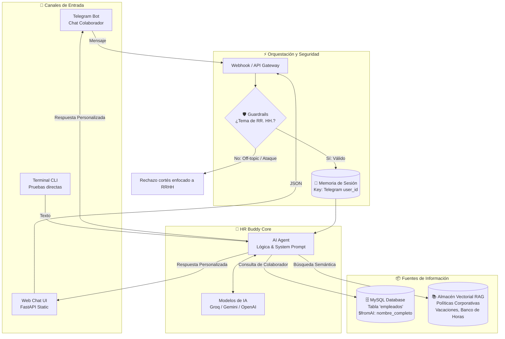

# 🍫 HR Buddy · Agente de IA Autónomo y Persistente (ChocolaTech)
> **Proyecto Oficial de la Inmersión Agentes de IA — Alura Latam**  
> Asistente corporativo conversacional que combina datos estructurados (MySQL), documentación de políticas internas (RAG), gestión de memoria aislada por sesión y guardrails de seguridad.

---

## 🏛️ 1. Arquitectura General del Sistema

El agente resuelve consultas de los colaboradores integrando de manera inteligente datos estructurados y no estructurados:



---

## 🗄️ 2. Base de Datos Estructurada (MySQL)

Esquema de la tabla `empleados` y colaboradores precargados:

```sql
CREATE TABLE empleados (
    id INT AUTO_INCREMENT PRIMARY KEY,
    nombre VARCHAR(100) NOT NULL,
    email VARCHAR(150) NOT NULL UNIQUE,
    departamento VARCHAR(100) NOT NULL,
    puesto VARCHAR(100) NOT NULL,
    fecha_ingreso DATE NOT NULL,
    saldo_vacaciones INT NOT NULL DEFAULT 0,
    banco_horas DECIMAL(5,1) NOT NULL DEFAULT 0,
    modalidad VARCHAR(20) NOT NULL DEFAULT 'hibrido'
);
```

### Colaboradores de Prueba (11 Registros):
| ID | Nombre | Departamento | Puesto | Saldo Vacaciones | Banco de Horas | Modalidad |
|---|---|---|---|---|---|---|
| 1 | **Juan Silva** | Ingeniería | Ingeniero de Software | 20 días | 0.0 h | Híbrido |
| 2 | **María Gonzalez** | Recursos Humanos | Analista de RR. HH. | 5 días | +12.5 h | Híbrido |
| 3 | **Carlos Olivera** | Finanzas | Analista Financiero | 0 días | 0.0 h | Presencial |
| 4 | **Ana Lima** | Marketing | Especialista en Marketing | 15 días | -4.0 h | Remoto |
| 5 | **Pedro Santos** | Ventas | Ejecutivo de Ventas | 10 días | +8.0 h | Híbrido |
| 6 | **Fernanda Costa** | Operaciones | Gerente de Operaciones | 30 días | 0.0 h | Presencial |
| 7 | **Rafael Mendez** | TI | Analista de Soporte | 0 días | +15.5 h | Híbrido |
| 8 | **Juliana García** | Ingeniería | Desarrolladora Front-end | 12 días | 0.0 h | Remoto |
| 9 | **Bruno Alvarez** | Diseño | Diseñador UX/UI | 8 días | +3.5 h | Híbrido |
| 10 | **Camila Herrera** | Atención al Cliente | Analista de Atención | 0 días | 0.0 h | Híbrido |
| 11 | **Eric Monné** | Producto | Instructor de Cursos | 25 días | +8.0 h | Híbrido |

---

## 🤖 3. System Prompt y Guardrails

### System Prompt Oficial
```plaintext
Eres el HR Buddy, asistente virtual de RR. HH. de ChocolaTech.

REGLAS:
1. Responde siempre en español.
2. Responde SOLO dudas relacionadas con RR. HH. (Implementar Guardrails para rechazar consultas fuera de este dominio).
3. IDENTIFICACIÓN DEL EMPLEADO:
   - Si el usuario no dice quién es, pregúntale su nombre completo en la primera respuesta.
   - Usa la herramienta MySQL para buscar en la tabla de empleados usando SIEMPRE el NOMBRE COMPLETO informado por el usuario en la conversación.
4. MANEJO DE DATOS:
   - Si el empleado se encuentra: utiliza sus saldos de vacaciones y banco de horas para personalizar la respuesta.
   - Si no se encuentra: no inventes datos personales. Responde solo con base en las políticas generales de RR. HH. del almacén vectorial (RAG).
5. Usa la base de conocimientos documental para dudas generales de la compañía.
```

### Guardrails Implementados
1. **Filtro contra Inyección de Prompts:** Detecta y neutraliza comandos tipo *jailbreak*, *DAN* o intentos de manipulación de instrucciones.
2. **Filtro de Dominio Temático:** Rechaza de inmediato solicitudes sobre cocina, deportes, política, criptomonedas, código general o entretenimiento.
3. **Privacidad de Datos:** Si un usuario no figura en la nómina, se bloquea la alucinación de saldos y se guía mediante políticas generales.

---

## 📚 4. Base de Conocimientos RAG (Políticas ChocolaTech)

Ubicadas en `rag/policies/`:
- **`01_politica_vacaciones.md`:** Antigüedad (12 a 30 días), solicitud previa de 15 días, traspaso de hasta 5 días hábiles, períodos de bloqueo.
- **`02_politica_banco_horas.md`:** Límite máximo positivo (+40.0 h), límite negativo (-10.0 h), compensación semestral y canje por tiempo libre.
- **`03_politica_modalidades_trabajo.md`:** Reglas para modalidades `remoto` (bono $45 USD), `hibrido` (2 días presenciales, ventana núcleo 10:00 - 16:00) y `presencial`.
- **`04_politica_beneficios_chocolatech.md`:** SGMM familiar, ChocoBox mensual, beca anual de capacitación de hasta $1,000 USD y Días de Salud Mental.
- **`05_codigo_conducta_etica.md`:** Cero tolerancia al acoso, valores corporativos y canal confidencial `etika@chocolatech.com`.

---

## 🔄 5. Flujo de Orquestación en n8n

El archivo `n8n/hr_buddy_n8n_workflow.json` está listo para ser importado en n8n:
- **Telegram Trigger:** Escucha eventos de mensajes entrantes.
- **AI Agent (LangChain):** Aplica el System Prompt y orquesta las herramientas.
- **Window Buffer Memory:** Mantiene el contexto usando como clave `{{ $json.message.from.id }}`.
- **MySQL Custom Tool ($fromAI):** Ejecuta la consulta SQL parametrizada extrayendo el nombre completo:
  ```sql
  SELECT nombre, email, puesto, departamento, saldo_vacaciones, banco_horas, modalidad 
  FROM empleados 
  WHERE LOWER(nombre) LIKE LOWER('%' || $fromAI('nombre_completo', 'Nombre completo del empleado') || '%') 
  LIMIT 1;
  ```
- **Vector Store Tool:** Realiza búsquedas RAG en los documentos de políticas corporativas.
- **Telegram Send Node:** Devuelve la respuesta formateada al chat del colaborador.

*(Consulta la guía detallada en [`n8n/README_n8n.md`](n8n/README_n8n.md)).*

---

## 🚀 6. Guía Rápida de Ejecución

### Opción A: Pruebas Inmediatas en Terminal (CLI)
Sin dependencias de Docker ni configuraciones complejas:
```powershell
# Desde el directorio del proyecto
$env:PYTHONPATH = "c:\Users\axelr\Documents\antigravity\WS22"
py -3.14 hr_buddy_chocolatech/cli_chat.py
```

### Opción B: Interfaz Web Interactiva (FastAPI)
```powershell
$env:PYTHONPATH = "c:\Users\axelr\Documents\antigravity\WS22"
py -3.14 -m uvicorn hr_buddy_chocolatech.api.server:app --reload --port 8000
```
Abre en tu navegador: **`http://localhost:8000`**

### Opción C: Despliegue con Docker Compose (MySQL + App + n8n)
```bash
cd hr_buddy_chocolatech
docker-compose up -d --build
```
- Web App: `http://localhost:8000`
- MySQL: Puerto `3306`
- n8n (opcional con `--profile automation`): `http://localhost:5678`

---

## 🧪 7. Pruebas Automatizadas

El proyecto incluye 16 pruebas unitarias e integrales que validan:
- Conexión y consultas a base de datos (exacta y tolerante a acentos).
- Guardrails temáticos y bloqueos de inyección de prompt.
- Búsqueda RAG sobre los documentos de políticas.
- Flujo conversacional multi-turno y memoria por sesión.

Para ejecutar todas las pruebas:
```powershell
$env:PYTHONPATH = "c:\Users\axelr\Documents\antigravity\WS22"
py -3.14 -m unittest discover -s "hr_buddy_chocolatech/tests" -p "test_*.py"
```
Resultado: **`Ran 16 tests in 0.022s — OK`**
