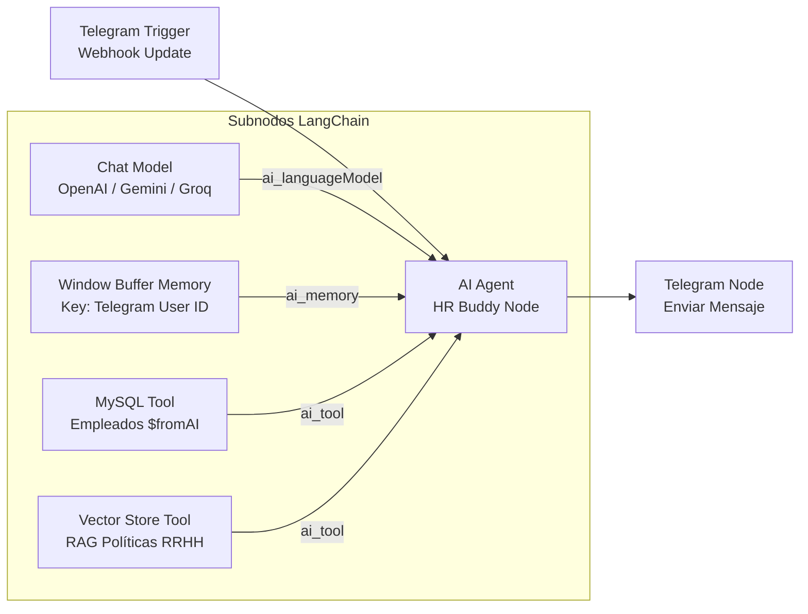

# Arquitectura y Guía de Orquestación en n8n: HR Buddy (ChocolaTech)

Este módulo contiene el flujo completo de automatización diseñado para **n8n** (versión 1.x o superior) correspondiente a la arquitectura de la **Inmersión Agentes de IA de Alura Latam**.

---

## 🏗️ 1. Diagrama de Conexiones del Flujo n8n



---

## 🧩 2. Componentes Clave en n8n

### A. Telegram Trigger (Webhook)
- **Función:** Recibe eventos en tiempo real vía Webhook cuando un colaborador envía un mensaje al bot de Telegram.
- **Parámetros extraídos:**
  - `{{ $json.message.text }}`: Texto enviado por el colaborador.
  - `{{ $json.message.from.id }}`: Identificador único del usuario de Telegram.
  - `{{ $json.message.chat.id }}`: ID del chat para enviar la respuesta.

### B. AI Agent (Tools Agent / LangChain)
- **System Prompt:** Configurado con el rol oficial de **HR Buddy**, delimitando las reglas de idioma español, guardrails de no salirse de temas de RR. HH., identificación obligatoria con nombre completo y no alucinación de datos personales.
- **Modo:** Agente con herramientas (Tools Agent / Function Calling).

### C. Window Buffer Memory (Aislamiento de Sesión)
- **Session Key:** `{{ $('Telegram Trigger').item.json.message.from.id }}`
- **Propósito:** Garantiza que cada empleado tenga su propio historial conversacional aislado. Si Juan Silva habla con el bot desde su cuenta, sus datos y turnos no se cruzan con los de María Gonzalez.
- **Ventana:** 10 interacciones para balancear contexto y consumo de tokens.

### D. Herramienta MySQL (`$fromAI`)
- **Consulta Dinámica:**
  ```sql
  SELECT nombre, email, puesto, departamento, fecha_ingreso, saldo_vacaciones, banco_horas, modalidad 
  FROM empleados 
  WHERE LOWER(nombre) LIKE LOWER('%' || $fromAI('nombre_completo', 'Nombre completo del empleado informado por el usuario') || '%') 
  LIMIT 1;
  ```
- **Lógica:** El modelo de IA extrae de la conversación el nombre del colaborador y lo inyecta dinámicamente como parámetro a la consulta SQL.

### E. Vector Store Tool (RAG de Políticas)
- Conecta a una colección vectorial con los documentos markdown de `01_politica_vacaciones.md`, `02_politica_banco_horas.md`, `03_politica_modalidades_trabajo.md`, `04_politica_beneficios_chocolatech.md` y `05_codigo_conducta_etica.md`.

---

## 🚀 3. Instrucciones de Importación en n8n

1. Abre tu instancia de **n8n** (local o en la nube, ej. `http://localhost:5678`).
2. Ve al menú superior derecho **"..."** > **"Import from File"** (o usa Ctrl+V para pegar).
3. Selecciona el archivo `n8n/hr_buddy_n8n_workflow.json`.
4. Configura tus credenciales:
   - **Telegram API:** Ingresa el Bot Token generado con `@BotFather`.
   - **OpenAI / Gemini / Groq API:** Ingresa tu API Key correspondiente.
   - **MySQL:** Configura host (`mysql` o `localhost`), puerto `3306`, usuario `root`, contraseña `chocolatech123` y base de datos `chocolatech`.
5. Activa el flujo mediante el toggle **"Active"**.
